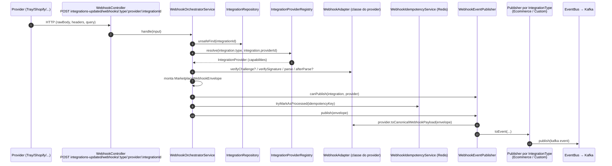
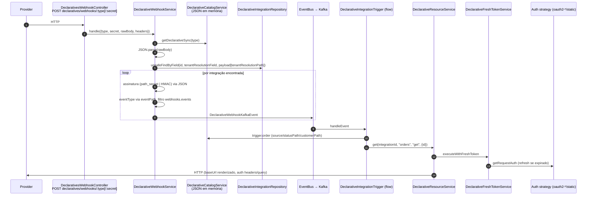
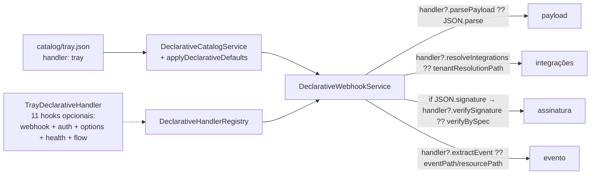
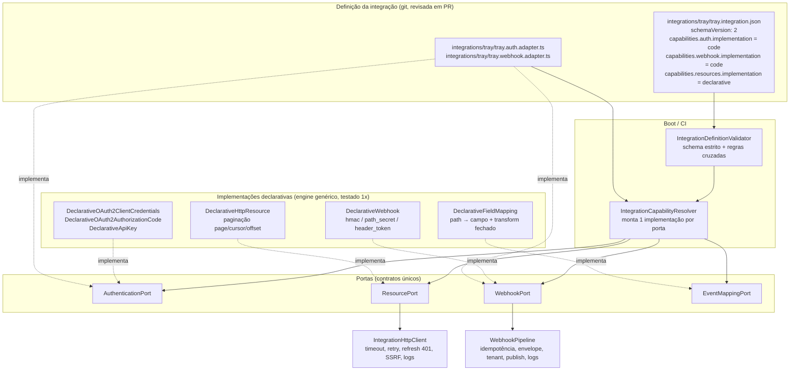
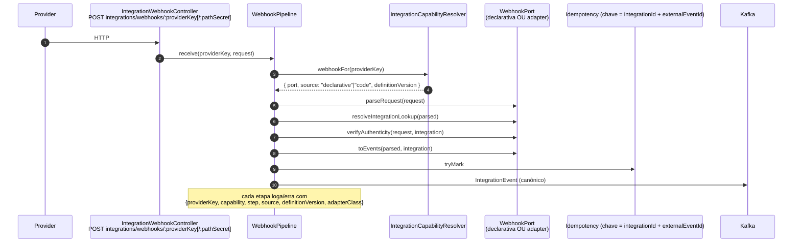
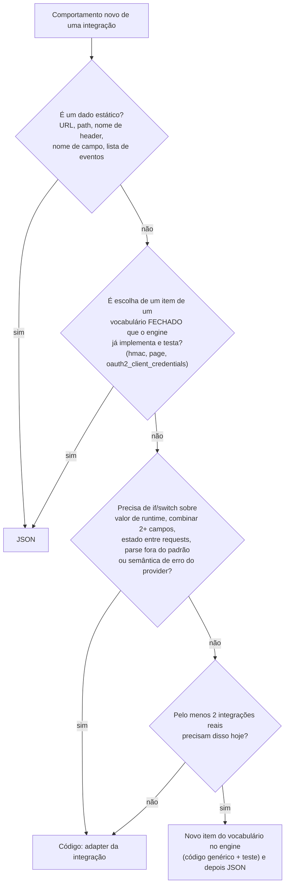

# Arquitetura híbrida de integrações (JSON + adapter): análise e plano

> Escopo: só análise e plano. Nenhum arquivo do repositório foi alterado.
> Fontes lidas:
> - `feat/spike-integrations-arch` (working tree atual): `src/services/crm/src/modules/integrations-updated`
> - `feat/integration-builder` (worktree temporário): `src/services/crm/src/modules/declaratives` + `flow/.../trigger/declaratives`
> - `stash@{0}` em `feat/integration-builder` (WIP não commitado): primeira tentativa de híbrido (`DeclarativeProviderHandler`). Entra na análise porque já é o embrião da Opção A.
>
> Abreviações: **SPIKE** = `integrations-updated`; **BUILDER** = `declaratives`; **STASH** = WIP do híbrido.

---

## Diagramas

### D1. SPIKE: fluxo de um webhook



### D2. BUILDER: fluxo de um webhook e de uma chamada de API



### D3. STASH: híbrido atual (JSON com hooks opcionais)



### D4. Proposta recomendada: portas por capacidade, cada uma resolvida para JSON **ou** código



### D5. Proposta: pipeline de webhook com rastreabilidade de origem



### D6. Critério de fronteira: JSON ou código?



### D7. Plano de migração (ordem)

```mermaid
flowchart LR
    S0["0. Módulo novo<br/>integration-platform<br/>integrationKey × externalAccountId"] --> S1["1. Portas + envelope<br/>+ schema v2 estrito"]
    S1 --> S2["2. Loader + validator<br/>+ resolver (boot/CI)"]
    S2 --> S3["3. Engine declarativo<br/>+ kit de helpers<br/>(reaproveita BUILDER)"]
    S3 --> S4["4. Pipeline webhook<br/>+ HTTP client + observabilidade<br/>(reaproveita orquestrador SPIKE)"]
    S4 --> S5["5. Yampi 100% JSON<br/>+ fixtures"]
    S5 --> S6["6. Tray híbrida<br/>auth + webhook + mapping em código<br/>resources em JSON<br/>shadow mode"]
    S6 --> S7["7. Remoção do legado<br/>e arquivamento das branches"]
    S7 -.-> S8["2ª leva: Nuvemshop,<br/>custom, Shopify, WhatsApp"]
```



---

## Fase 1: entender cada abordagem

### 1.1 SPIKE: `feat/spike-integrations-arch` → `integrations-updated`

**Estrutura**

```
integrations-updated/
  domain/
    repositories/integration-provider.port.ts   ← contratos centrais
    entities/integration.ts, integration-definition.ts
    helpers/execute-with-fresh-token.ts
    value-objects/ (envelope, canonical-order/message, custom-field-schema)
  application/
    controllers/webhook.controller.ts, integrations-updated.controller.ts
    services/webhook-orchestrator.service.ts      ← fluxo principal de webhook
    services/integration-provider.registry.ts
    services/integration-auth.service.ts          ← connect/confirm em 2 passos (staged no Redis)
    services/payload-mapper.service.ts            ← JSONPath p/ provider "custom"
    services/webhook-idempotency.service.ts
  infra/
    providers/{tray,shopify,whatsapp,custom}/     ← 1 pasta por provider, N adapters
    catalog/templates/*.json                      ← templates declarativos (só p/ provider "custom")
    catalog/integration-template-writer.service.ts
    publishers/{ecommerce,custom}/
  integrations-updated.module.ts                  ← registro manual de tudo
```

**Contratos centrais** (`domain/repositories/integration-provider.port.ts`)

- `IntegrationProvider` (abstract): `providerId`, `type`, `displayName`, `capabilities`, `toEnvelope()`, opcionais `toCanonicalWebhookPayload/Order/Message`.
- `ProviderCapabilitySet`: `{ webhook?: WebhookAdapter; auth?: AuthenticationAdapter; customFields?: CustomFieldsAdapter }`. Essa é a melhor ideia da branch: **capacidades como portas separadas**.
- `WebhookAdapter`: `verifySignature`, `parse`, opcionais `afterParse`, `matchInstances`, `verifyChallenge`.
- `AuthenticationAdapter`: `authenticate`, `extractExternalId`, `refresh`.
- `CustomFieldsAdapter`: `schema` + `extract`.

**Fluxo** (D1): `WebhookController` → `WebhookOrchestratorService.handle` (`webhook-orchestrator.service.ts:37-121`) → registry → adapter → envelope → idempotência no Redis → `WebhookEventPublisher` → publisher por `IntegrationType` → Kafka. Chamadas de saída: `TrayApiClient` usa `executeWithFreshToken` (refresh em 401, 1 tentativa).

**O que tem de declarativo**: só o provider `custom`. `custom.config.schema.ts` expressa: estratégias de segurança (`urlSecret`, `hmac`, `headerToken`), `eventTypePath`, `externalIdPath`, `idempotencyKeyPath`, `fields[]` com JSONPath e transform de uma lista fechada (`lowercase`, `uppercase`, `toNumber`, `toDate`, `default`, `enumLookup`), resposta HTTP. Não tem auth de saída, paginação, retry nem chamadas de API.

**Como se cria uma integração nova**: pasta em `infra/providers/<nome>/`, classe `XIntegrationProvider` + 1 classe por adapter, e registro manual em 2 lugares do `integrations-updated.module.ts` (lista de providers em `:93-100` e `integrationProviderClasses` em `:56-61`). Para um webhook "custom": um JSON em `catalog/templates/` ou via `IntegrationTemplateWriter` em runtime.

**Testes**: 4 specs, todas de schema/validação de campos (`custom-field-schema.spec.ts`, `integration-template.schema.spec.ts`, `integration-template-writer.service.spec.ts`, `template-integration-fields.service.spec.ts`). **Zero teste** de orquestrador, adapter Tray, auth, idempotência ou publishers.

**Pontos fortes**
- Portas por capacidade (`ProviderCapabilitySet`) e registry: o desenho de contrato é bom.
- Orquestrador com etapas claras (challenge → assinatura → parse → envelope → idempotência → publish) e rollback da chave de idempotência em falha (`:111-117`).
- Lock distribuído + releitura no refresh da Tray (`tray.authentication.adapter.ts:98-126`) evita refresh duplo.
- Fluxo de conexão em 2 passos com dado "staged" no Redis e checagem de tenant (`integration-auth.service.ts`).

**Problemas de design e bugs visíveis** (em ordem de gravidade)

1. **`providerId` tem dois significados.** No registry é o tipo do provider (`"tray"`, `tray.integration-provider.ts:16`); na entidade é o id externo da loja (`Integration.new({ providerId: staged.externalId })`, `integration-auth.service.ts:109-114`; `refresh` usa `integration.providerId` como `storeId`, `tray.authentication.adapter.ts:88`). Consequência: `createOrReuse` chama `providerRegistry.resolve(staged.type, staged.externalId)` (`:106`) e o orquestrador chama `resolve(integration.type, integration.providerId)` (`webhook-orchestrator.service.ts:48`). Para a Tray isso procura `ECOMMERCE:<storeId>` e lança `integration_provider_not_found`. O caminho principal da Tray não fecha.
2. **`TrayWebhookAdapter.parse` lê camelCase** (`payload.scopeName`, `payload.sellerId`, `tray.webhook.adapter.ts:15-23`), mas o tipo `TrayWebhookPayload` (`tray.types.ts:34-42`) e a Tray real usam snake_case (`scope_name`, `seller_id`). Além disso a Tray envia `x-www-form-urlencoded` e o parse faz `JSON.parse(rawBody)` sem `try`. Resultado: `unknown.unknown` ou erro 500.
3. **Rota com secret no path não existe.** `webhook.controller.ts:16-17` empilha dois `@Post(...)` no mesmo método. No Nest o último decorator aplicado sobrescreve o metadata de path, então só `:type/:provider/:integrationId` é registrado (o BUILDER faz certo: `@Post([":type", ":type/:secret"])`).
4. **Shopify e WhatsApp aceitam qualquer request**: `verifySignature` retorna `true` com `// TODO` (`shopify.webhook.adapter.ts:6-9`, `whatsapp.webhook.adapter.ts:6-9`). `verifyChallenge` do WhatsApp devolve `hub.challenge` sem checar `hub.verify_token`. O parse do WhatsApp (`:17-19`) faz `entry.changes?.value` (é array) e quebra com `entry` undefined.
5. **Boot quebra com o catálogo atual**: `catalog/templates/spec-temp-webhook.json` está versionado e vazio (0 bytes). `readTemplateFiles` faz `JSON.parse` fora do `try` (`integration-template-catalog.service.ts:88-94`, o `try` em `:66-71` só cobre o `parse` do schema). O módulo é importado em `crm.module.ts` e o `nest-cli.json` copia `templates/*.json`. O construtor lança e o app não sobe.
6. **Escrita de JSON em disco em runtime** (`IntegrationTemplateWriter.save` → `join(__dirname, "templates")`). Em `dist/` de container isso some no próximo deploy e não propaga entre réplicas. O próprio comentário diz "committed to templates/ … reviewed in a pull request", o que não acontece.
7. **Chave de idempotência sem namespace**: `webhook:idempotency:<idempotencyKey>` (`webhook-idempotency.service.ts:22`). Para `custom` a chave é `$.id` do payload: dois tenants mandando `id: 123` colidem e o segundo é descartado. O fallback é um hash de 32 bits (`custom.webhook.adapter.ts:205-214`), com colisão provável em volume.
8. **Tokens em texto puro** em `integration.fields` (`tray.authentication.adapter.ts:56-69`, `:112-121`). O BUILDER criptografa.
9. **Duplicação**: o mesmo literal de envelope existe 5 vezes (`toEnvelope` em 4 providers + orquestrador); `resolveApiAddress` da Tray copiado em `tray.api.client.ts:52` e `tray.authentication.adapter.ts:144`; `safeCompare` em 2 lugares.
10. **Caminho morto**: `ReceiveWebhookCommand` + `MarketplaceEventHandler` fazem o mesmo que o orquestrador e terminam em `console.log` com `TODO` (`marketplace-event.handler.ts:49-51`).
11. `TrayWebhookAdapter.verifySignature` usa um segredo global `TRAY_WEBHOOK_SECRET`, embora exista o campo por integração `webhookSecret` (`tray.custom-fields.adapter.ts:72-78`), que não é usado.
12. `CustomWebhookAdapter.resolveSecret` devolve o primeiro segredo não vazio de **qualquer** estratégia (`:147-157`), não o da estratégia que está sendo verificada.

### 1.2 BUILDER: `feat/integration-builder` → `declaratives`

**Estrutura**

```
declaratives/
  catalog/{tray,nuvemshop,yampi}.json          ← 1 JSON por provider
  domain/declarative.schema.ts                  ← zod do JSON (352 linhas)
  application/
    services/declarative-catalog.service.ts     ← lê pasta, cache em memória, save em disco
    services/declarative-webhook.service.ts     ← interpreta webhooks
    services/declarative-resource.service.ts    ← interpreta resources/operations (HTTP)
    helpers/declarative-template.ts             ← {{ }} e { } (mini template engine)
    helpers/webhook-signature.ts, api-address.ts (anti-SSRF)
  auth/
    methods/oauth2-authorization-code | oauth2-client-credentials | oauth2-credentials | static
    declarative-auth.strategies.ts, declarative-fresh-token.service.ts
flow/.../trigger/declaratives/declarative-integration.trigger.ts
```

**Engine**: não há classe "interpreter" única. São três interpretadores: `DeclarativeWebhookService` (entrada), `DeclarativeResourceService` (saída HTTP) e as estratégias de auth, escolhidas por `supports(authentication)` (`declarative-auth.strategies.ts:23-25`, ex.: `type === "oauth2" && flow === "credentials"`).

**O que o JSON expressa hoje** (`declarative.schema.ts`)

| Área | Expressa | Observação |
|---|---|---|
| Auth | oauth2 (`authorization_code` c/ PKCE, `client_credentials`, `credentials`), static (api key/basic) | `type`, `flow` são strings livres (`optionalString`), não enum |
| Credenciais | `credentials.*.source: "env"` + `envName` | segredo por referência, bom |
| Requisição autenticada | `requestHeaders`, `requestQuery` com `{{auth.accessToken}}` | |
| API | `baseUrl`, `defaultHeaders`, `pagination` (só `type: "page"` implementado), `addressValidation` (anti-SSRF) | |
| Resources | `resources.<r>.operations.<op>`: method, path, `responsePath`, `responseItemsPath` (`Orders[].Order`), `options.labelPath/valuePath` | |
| Webhook | `events`, `endpoint`, `registration` (só descritivo), `payload.eventPath/resourcePath/tenantResolution*`, `signature` (path_secret ou HMAC sha1/256/512 hex/base64) | `payload.contentType` é declarado mas **ignorado** |
| UI | `configuration.fields` (tipos, select, validação), `ui`, `nextStep` | |
| Flow | `trigger.order.source/statusPath/customerPath/customerPhoneDefaultCountryCode` | regra de negócio de e-commerce dentro do schema genérico |
| Retry | não (só 1 refresh em 401; o retry de 5xx está hardcoded no trigger, `declarative-integration.trigger.ts:140-148`) | |
| Erros | não | |
| Idempotência | não | |

**Como se cria uma integração nova**: um arquivo `catalog/<id>.json` (ou `DeclarativeCatalogService.save`, que também escreve em disco). Não precisa registrar nada. Para aparecer como trigger no flow, o trigger é instanciado por `providerId`.

**Testes**: 6 specs (`declarative.schema.spec`, `declarative-template.spec`, `api-address.spec`, `declarative-resource.service.spec`, `declarative-webhook.service.spec`, `declarative-fresh-token.service.spec`) + `declarative-integration.trigger.spec`. Testam o engine, não cada integração: não há fixtures de webhook real da Tray/Nuvemshop/Yampi.

**Pontos fortes**
- Integração simples sai em um arquivo, sem registro em módulo.
- Segredos por referência a env, tokens criptografados (`CryptoHelpers.encrypt`, `oauth2-credentials.auth.service.ts:166-175`).
- Anti-SSRF com `blockPrivateNetworks` e `maxRedirects: 0` (`declarative-resource.service.ts:84-86`).
- Refresh com lock distribuído e detecção de "já foi renovado" (`declarative-fresh-token.service.ts:56-76`).
- Mensagens de validação com path (`parseDeclarative` → `configuration.fields[2].source`).
- Rota com secret no path registrada do jeito certo.

**Problemas de design e bugs visíveis**

1. **A validação do JSON é decorativa.** `findAll` loga `warn` quando o schema falha e carrega o conteúdo **cru** mesmo assim (`declarative-catalog.service.ts:41-46`: `declaratives[id] = { ...content, id }`). Os `transform` do zod (`toUpperCase` do método etc.) nunca chegam ao runtime. Um JSON inválido sobe e falha só no primeiro webhook.
2. **O engine "genérico" já tem a Tray dentro.** `OAuth2CredentialsAuthService.request` faz `renderTemplate("{{fields.storeDomain}}", …)` hardcoded (`oauth2-credentials.auth.service.ts:129`) e `DEFAULT_OFFSET = "-03:00"` para datas sem timezone (`:20`, `:178-187`), que é o formato da Tray. O flow `"credentials"` só existe por causa da Tray. **É a evidência mais forte de que o purismo não se sustenta**: a exceção vazou para o engine em vez de ficar num adapter.
3. **Yampi não funciona como está no JSON.** `api.baseUrl` usa `{alias}` com chave simples (`yampi.json`), mas o render roda com contexto `{ fields }` e a regex `SINGLE` só substitui se `readPath(context, "alias")` existir. Não existe, então a URL fica literalmente com `{alias}`. Também não há `tenantResolutionPath/Field`, então o webhook chama `unsafeFindByField(id, undefined, "undefined")`. As credenciais Yampi não têm `envName`, então `process.env[undefined]`.
4. **Duas sintaxes de template** (`{{fields.x}}` e `{x}`) mais strings com mini-DSL: `"grant_type=authorization_code"` em `authorizationCodeRequest`, `"resource:orders.get"` em `source`, `"credentials.webhookSecret"` em `secretSource`, `eventPath` que aceita `{{ }}` (`declarative-webhook.service.ts:87-92`). É uma linguagem nascendo dentro de strings, sem tipo e sem erro de compilação.
5. **Três implementações de `readPath`** com semânticas diferentes: `declarative-template.ts:29` (suporta `[0]` e `$.`), `webhook-signature.ts:38` (só ponto), `declarative-integration.trigger.ts:18` (só ponto).
6. **Webhook sem idempotência** e sem envelope canônico. O evento Kafka carrega o `payload` cru do provider.
7. **Assinatura opcional por omissão**: se `webhooks.signature` não existe, nada é verificado (`declarative-webhook.service.ts:52`). Inseguro por padrão.
8. **`payload.contentType` ignorado**: o webhook sempre faz `JSON.parse(rawBody)`. Tray (form-urlencoded) depende de `rawBody` não estar presente para cair no `JSON.stringify(request.body)` do controller.
9. **Escrita em disco em runtime** (`save` → `fs.writeFile`) + cache por processo: mesmo problema do SPIKE (réplicas e deploy).
10. **Acoplamento flow ↔ schema**: `trigger.order.*` (status, customer, DDI 55) é regra de e-commerce no schema genérico, e o trigger lê o JSON via `GetDeclarativeQuery` a cada evento (`declarative-integration.trigger.ts:131-135`).
11. Mesma tabela `integrationEntity` que o SPIKE, mas aqui `providerId = "tray"` e o id da loja vai em `fields.storeId`. As duas branches gravam **semânticas opostas na mesma coluna**.

### 1.3 STASH: o híbrido WIP (`stash@{0}` em `feat/integration-builder`)

- `DeclarativeProviderHandler` com **11 hooks opcionais** misturando 5 domínios: webhook (`parsePayload`, `resolveIntegrations`, `verifySignature`, `extractEvent`), auth (`parseTokenResponse`), UI (`mapOptions`), health (`healthCheck`) e flow (`loadOrder`, `resolveStatus`, `resolveCustomer`).
- Ligação explícita: `"handler": "tray"` no JSON + `DeclarativeHandlerRegistry` (`Map` por `providerId`).
- `applyDeclarativeDefaults` expande boilerplate no boot (envName derivado `TRAY_CONSUMER_KEY`, labels i18n, retry `{attempts: 2, retryOn: [429,502,503,504]}`).
- Tem testes de handler bons (`declarative-handlers.spec.ts`): form-urlencoded da Tray, HMAC da Nuvemshop, data da Tray, status customizados.

**Problemas**
- **Precedência ambígua**: `handler?.verifySignature?.(...) ?? this.verifyBySpec(...)`. "Retornar `undefined` = usar o JSON" é uma convenção invisível, e o hook só roda **se o JSON tiver `signature`**. Quem lê o JSON não sabe que a Tray ignora metade dele.
- **Duas fontes de verdade**: `NuvemshopDeclarativeHandler.verifySignature` reimplementa o HMAC base64 que o `nuvemshop.json` já declara (`x-linkedstore-hmac-sha256`, `HMAC-SHA256`, `base64`). Se alguém mudar o JSON, nada muda.
- **Interface "saco de hooks"**: granularidade fina demais (por etapa interna) e larga demais (5 domínios). Cada novo caso vira mais um hook opcional no mesmo interface.
- **Defaults implícitos** (`envName` derivado do id, `category: "ecommerce"` para todo mundo) deixam o JSON curto mas escondem configuração. Para debug em produção é pior: o valor efetivo não está em lugar nenhum legível.

---

## Fase 2: comparação

| Critério | SPIKE (código) | BUILDER (JSON puro) | Comentário |
|---|---|---|---|
| Velocidade p/ integração simples | Baixa: 3-5 classes + 2 registros no módulo | **Alta**: 1 arquivo | BUILDER vence se a integração couber no vocabulário |
| Casos complexos | **Alta**: código livre (lock, form-urlencoded, datas) | Baixa: a exceção vazou para o engine (`storeDomain`, `-03:00`) ou não funciona (Yampi `{alias}`) | o purismo já quebrou com 3 providers |
| Testabilidade | Boa em tese (classes puras), **0 testes** de adapter na prática | Engine testado; integrações sem fixture, então JSON quebrado passa | nenhum dos dois testa "este payload real da Tray vira este evento" |
| Legibilidade / onboarding | Familiar (TS, tipos); duplicação de envelope confunde | JSON fácil de ler; **difícil saber o que o engine faz com cada chave** (strings livres, 2 sintaxes de template) | |
| Observabilidade / debug | Status no retorno (`invalid_signature`, `idempotent`...), sem log estruturado; erros genéricos (`integration_provider_not_found:...`) | Quase nada: `warn` no boot, status no retorno. Não dá para saber se o erro foi do JSON ou do engine | nenhum distingue config × código × provider |
| Versionamento / evolução | Código em git; `metadata.schemaVersion: 1` hardcoded; `mappingVersion` só no custom | `schemaVersion` e `provider.version` são strings opcionais sem efeito; save em runtime sem histórico | ambos sem migração de definição |
| Segurança | Tokens em claro; Shopify/WhatsApp sem assinatura; idempotência sem namespace | Tokens criptografados; anti-SSRF; mas assinatura opcional por omissão e JSON inválido carregado | BUILDER é melhor aqui |

---

## Fase 3: critério de fronteira JSON × código (o mais importante)

### 3.1 Regra objetiva

Uma chave pode ir para o JSON **somente se** passar nos três testes:

1. **É dado, não decisão.** Valor estático (URL, path, nome de header, nome de campo, lista de eventos, label) **ou** escolha de um item de um **vocabulário fechado** (enum) que o engine implementa e testa uma vez: `hmac_sha256_base64`, `pagination: page | cursor | offset`, `oauth2_client_credentials`.
2. **Não tem parâmetro que codifica lógica.** Um mapeamento `path → campo` com transform da lista fechada é dado. Uma transform que recebe expressão, condição ou template composto não é.
3. **Já é usada (ou será no próximo trimestre) por ≥ 2 integrações reais.** Se só um provider precisa, é código no adapter dele. Generalizar para o engine só quando o segundo caso aparecer ("regra de três" relaxada para dois, porque o custo de uma chave errada no schema é alto: ela vira contrato).

Vai para **código** (adapter da integração) qualquer coisa que tenha:

- `if/switch` sobre valor de runtime (ex.: "só escopo `order` interessa", Tray `extractEvent`);
- combinação de 2+ campos em um valor (ex.: `tray:${seller}:${resource}:${act}`);
- estado entre requests ou entre etapas (lock, cache, fluxo multi-step, "fetch pedido depois do webhook");
- parse fora do padrão (form-urlencoded misturado com JSON, data sem timezone, envelope aninhado tipo WhatsApp);
- autenticação fora dos fluxos padrão (Tray: troca de `code` + `consumer_key` sem redirect, refresh por `GET ?refresh_token=`, `api_host` por loja);
- semântica de erro do provider (ex.: 401 que significa "loja suspensa", 429 com header próprio, erro em corpo 200).

### 3.2 Sinais de alerta (o JSON está virando linguagem)

| Sinal | Já aparece em |
|---|---|
| String com mini-sintaxe interpretada | `"grant_type=authorization_code"`, `"resource:orders.get"`, `"credentials.webhookSecret"`, `{{ }}` em `eventPath` |
| Duas sintaxes para a mesma coisa | `{{fields.x}}` × `{x}` (quebrou a Yampi) |
| Chave que só um provider usa | `trigger.order.customerPhoneDefaultCountryCode`, `api.addressValidation.pathname: "/web_api"`, `flow: "credentials"` |
| String livre onde deveria ser enum | `authentication.type`, `flow`, `pagination.type`, `signature.type`, `comparison` |
| Engine com nome de campo de um provider | `"{{fields.storeDomain}}"` hardcoded na estratégia OAuth |
| `record<string, unknown>` de opções | `transformOptions` (SPIKE) |
| Condicional, loop, expressão, referência a outro passo | ainda não, e deve ser **proibido no schema** |

Regra prática para review: **se precisa de teste unitário para confiar no trecho, ele não é JSON.**

### 3.3 Onde cada integração real cairia

| Integração | Auth | Webhook | Resources/API | Mapeamento p/ flow | Resultado |
|---|---|---|---|---|---|
| `generic-webhook` / `crm-hmac-webhook` (SPIKE templates) | — | JSON (`path_secret`/`hmac`) | — | JSON (path → campo) | **100% JSON** |
| Nuvemshop | JSON (`oauth2_authorization_code`) | JSON (HMAC base64 com client secret, `store_id → user_id`, `event`) | JSON | JSON (`payment_status`, `customer`) | **100% JSON**. O `verifySignature` do STASH deve ser apagado |
| Yampi | JSON (`authorization_code` + PKCE) | JSON (HMAC base64) | JSON, **após corrigir** `{alias}` para `{{fields.alias}}` | JSON | **100% JSON** (a confirmar: como resolver tenant, ver Q7) |
| Shopify (SPIKE, stub) | JSON (`authorization_code`) | JSON se o schema aceitar evento vindo de **header** (`X-Shopify-Topic`); hoje o SPIKE lê `payload.topic`, que não existe | JSON | JSON | provável **100% JSON** |
| Tray | **código** (troca sem redirect, refresh por GET, `api_host` por loja, data -03:00) | **código** (form-urlencoded, filtro de escopo, eventType composto, segredo no path) | JSON (`orders.get`, `orderStatuses.list`) | código só para `mapOptions` (status custom × padrão) | **híbrida** |
| WhatsApp Cloud | JSON (token estático) | **código** (challenge com `verify_token`, payload aninhado com N mensagens → N eventos) | JSON | código | **híbrida** |

---

## Fase 4: arquitetura híbrida (opções)

Premissa comum às três opções: **um contrato só** (as portas do SPIKE, revisadas) e **o engine declarativo é uma implementação dessas portas**. O que muda entre as opções é a granularidade em que o código pode substituir o JSON.

### Opção A: JSON base + hooks finos (evolução do STASH)

- **Conexão**: o engine roda sempre; em cada etapa pergunta ao handler `handler.hookX?.() ?? comportamentoDoJson()`.
- **Interface**: ~10-15 hooks opcionais por etapa (`parsePayload`, `resolveIntegrations`, `verifySignature`, `extractEvent`, `parseTokenResponse`, `mapOptions`...). Default = JSON.
- **Prós**: menor mudança a partir do STASH; adapter pequeno.
- **Contras**: precedência implícita (`undefined` = fallback); JSON e handler podem descrever a mesma coisa de formas diferentes; o interface cresce a cada provider; o engine precisa conhecer todos os hooks; para entender a Tray é preciso ler JSON + handler + engine.

### Opção B: portas por capacidade, implementação escolhida no JSON (recomendada)

- **Conexão**: cada capacidade (`authentication`, `webhook`, `resources`, `eventMapping`) declara `implementation: "declarative" | "code"`. Se `declarative`, o bloco de config é obrigatório e o engine implementa a porta. Se `code`, o bloco declarativo daquela capacidade é **proibido** (schema falha) e o adapter registrado implementa a porta inteira. O adapter **recebe a definição** (URLs, credenciais por referência) e pode **reusar peças do engine** por composição (ex.: `IntegrationHttpClient`, `verifyHmacSignature`) em vez de herdar e sobrescrever.
- **Regra de previsibilidade**: para cada capacidade existe **exatamente uma fonte**. Isso é validado no boot.
- **Prós**: sem precedência ambígua; o JSON diz onde olhar; os adapters têm contrato pequeno e estável (a porta); o engine não conhece providers.
- **Contras**: substituir uma capacidade inteira é mais código que um hook (ex.: Tray reescreve o webhook inteiro, ~60 linhas); exige um bom kit de helpers reutilizáveis para não duplicar.

### Opção C: vocabulário de estratégias nomeadas (registry de estratégias)

- **Conexão**: o JSON nunca diz "code"; ele escolhe estratégias por nome em cada ponto: `"signature": { "strategy": "tray_path_secret" }`, `"payloadParser": "form_or_json"`. Estratégias custom são classes registradas por nome.
- **Prós**: muito granular e reutilizável entre providers.
- **Contras**: vira um plugin system; a lista de pontos de extensão cresce como na A; difícil saber o que é genérico e o que é de um provider só; mais infraestrutura do que o volume atual (3-6 integrações) justifica.

### Recomendação: **Opção B**, com um "escape" limitado da C

B como regra. Da C, aproveitar só o seguinte: quando um comportamento de código aparece em **duas** integrações (ex.: parser form-urlencoded), ele vira item do vocabulário do engine (`payload.format: "form_urlencoded"`), e não uma estratégia nomeada plugável.

#### Interface do adapter (portas)

```ts
export interface AuthenticationPort {
    startConnection(request: StartConnectionRequest): Promise<StartConnectionResult>;
    completeConnection(request: CompleteConnectionRequest): Promise<ConnectionCredentials>;
    refreshCredentials(integration: IntegrationRecord): Promise<ConnectionCredentials>;
    buildRequestAuthentication(credentials: ConnectionCredentials): RequestAuthentication;
}

export interface WebhookPort {
    parseRequest(request: InboundWebhookRequest): ParsedWebhook;
    findIntegrationLookup(parsedWebhook: ParsedWebhook): IntegrationLookup;
    verifyAuthenticity(request: InboundWebhookRequest, integration: IntegrationRecord): AuthenticityResult;
    extractEvents(parsedWebhook: ParsedWebhook, integration: IntegrationRecord): IntegrationEvent[];
    answerChallenge?(request: InboundWebhookRequest): ChallengeAnswer | undefined;
}

export interface ResourcePort {
    fetchOne(integration: IntegrationRecord, resourceName: string, identifier: string): Promise<unknown>;
    fetchPage(integration: IntegrationRecord, resourceName: string, pageRequest: PageRequest): Promise<ResourcePage>;
}

export interface EventMappingPort {
    toFlowContext(event: IntegrationEvent, resourceData: unknown): FlowContext;
    toFieldOptions(resourceName: string, items: unknown[]): FieldOption[];
}
```

Comportamento quando não há adapter: a porta é implementada pelo engine a partir do bloco declarativo. Quando a capacidade não existe na definição (ex.: integração sem auth), a porta não é registrada e o pipeline trata como "não suportado" com erro explícito (não `return true`).

Pontos que **nunca** são da porta (ficam no pipeline, iguais para todos): tenant/sessão, idempotência (`integrationId + externalEventId`), envelope canônico, publicação Kafka, retry de saída, refresh em 401, SSRF, timeouts, logs e métricas. É isso que garante previsibilidade: o adapter decide **o que** o provider significa, nunca **como** a plataforma processa.

#### Exemplo de adapter (Tray, webhook em código)

```ts
export class TrayWebhookAdapter implements WebhookPort {
    constructor(private readonly secretReader: IntegrationSecretReader) {}

    parseRequest(request: InboundWebhookRequest): ParsedWebhook {
        return { fields: parseFormOrJsonBody(request.rawBody) };
    }

    findIntegrationLookup(parsedWebhook: ParsedWebhook): IntegrationLookup {
        return { externalAccountId: String(parsedWebhook.fields.seller_id) };
    }

    verifyAuthenticity(request: InboundWebhookRequest): AuthenticityResult {
        const expectedSecret = this.secretReader.read("TRAY_WEBHOOK_SECRET");
        return compareSecretsInConstantTime(request.pathSecret, expectedSecret);
    }

    extractEvents(parsedWebhook: ParsedWebhook): IntegrationEvent[] {
        if (parsedWebhook.fields.scope_name !== "order") {
            return [];
        }
        return [buildTrayOrderEvent(parsedWebhook.fields)];
    }
}

function buildTrayOrderEvent(fields: Record<string, string>): IntegrationEvent {
    return {
        eventType: `order_${fields.act}`,
        externalEventId: `${fields.scope_id}:${fields.act}`,
        resourceIdentifier: fields.scope_id
    };
}
```

#### Estrutura de arquivos de exemplo

```
integrations/
  engine/                       ← implementações declarativas das portas + pipeline (genérico)
  definitions/
    generic-webhook/            ← 100% JSON
      generic-webhook.integration.json
      fixtures/
        order-created.request.json
        order-created.expected-events.json
    nuvemshop/                  ← 100% JSON
      nuvemshop.integration.json
      fixtures/...
    tray/                       ← híbrida
      tray.integration.json     (resources: declarative; authentication/webhook: code)
      tray.authentication.adapter.ts
      tray.webhook.adapter.ts
      tray.event-mapping.adapter.ts
      tray.module.ts            (registra os adapters)
      fixtures/...
      tray.webhook.adapter.spec.ts
    whatsapp-cloud/             ← código quase total
      whatsapp-cloud.integration.json  (só metadata, UI e authentication declarativa)
      whatsapp-cloud.webhook.adapter.ts
      ...
```

Exemplo do bloco de capacidades no JSON híbrido:

```json
{
  "schemaVersion": 2,
  "integration": { "key": "tray", "name": "Tray", "definitionVersion": "3.0.0", "category": "ecommerce" },
  "authentication": { "implementation": "code" },
  "webhook": { "implementation": "code", "endpointSecret": { "env": "TRAY_WEBHOOK_SECRET" } },
  "resources": {
    "implementation": "declarative",
    "baseUrl": { "fromField": "apiHost", "appendPath": "/web_api", "requireHttps": true, "blockPrivateNetworks": true },
    "authenticationPlacement": { "in": "query", "name": "access_token" },
    "items": {
      "orders": { "fetchOne": { "method": "GET", "path": "/orders/{identifier}/complete", "responsePath": "Order" } },
      "orderStatuses": { "fetchPage": { "method": "GET", "path": "/orders/statuses", "itemsPath": "OrderStatuses[].OrderStatus", "pagination": "page" } }
    }
  }
}
```

Note que `baseUrl` deixa de ser template livre (`{{fields.storeDomain}}`) e vira estrutura tipada (`fromField`, `appendPath`). O mesmo vale para `requestQuery`, que vira `authenticationPlacement`.

#### Validação do JSON

- Schema zod **estrito**, com enums fechados, `discriminatedUnion` por `implementation` e `schemaVersion` obrigatório.
- **O runtime usa o resultado do `parse`**, nunca o conteúdo cru (corrige o BUILDER).
- Regras cruzadas no boot: `implementation: "code"` exige adapter registrado com a mesma `key`; adapter registrado sem definição é erro; adapter que implementa capacidade marcada `declarative` é erro; `fromField` precisa existir em `configuration.fields`; env referenciada precisa existir (em produção, falha; em dev, warn).
- **Fail fast**: definição inválida derruba o boot em dev/CI. Em produção, a decidir (Q4): derrubar ou desabilitar só aquela integração com alerta.
- Teste de CI que carrega todas as definições (o STASH já tem o embrião: `it.each(["tray","nuvemshop","yampi"])`).
- Mensagens: `tray.integration.json › resources.items.orders.fetchOne.path: deve começar com "/" (recebido "orders/{identifier}")`.

#### Registro e descoberta

- Definições: arquivos versionados no git, carregados no boot. **Sem escrita em disco em runtime** (remover os dois writers). Se o builder de UI precisa existir, ele gera um PR ou grava numa tabela versionada (Q2).
- Adapters: cada integração com código exporta um `XIntegrationModule` que registra seus adapters com um token `{ key, capability }`. O `IntegrationCapabilityResolver` junta definição + adapters e monta um `ResolvedIntegration` imutável por `key`.
- Um endpoint/admin `GET /integrations/definitions/:key/resolved` mostra, por capacidade, `source` e `adapterClass`. Responde "de onde vem isso?" sem ler código.

#### Versionamento

- `schemaVersion` (inteiro) = versão do **formato** do JSON. O engine suporta a atual e a anterior; migração é uma função pura `migrateDefinitionFromVersion1ToVersion2`, testada com os JSONs reais.
- `definitionVersion` (semver) = versão **daquela integração**. Vai no envelope de todo evento e em todo log.
- Mudança que altera o formato do evento publicado (campo removido/renomeado) = major de `definitionVersion` + consumidor tolerante ou tópico/versão de evento nova.
- Integrações em produção guardam a `definitionVersion` com que foram conectadas (para detectar reconexão necessária quando a auth muda).

#### Testes por tipo

| Tipo | O que testar | Como |
|---|---|---|
| Engine | cada item do vocabulário (hmac, page, oauth2...) | unit, 1x |
| 100% JSON | a definição: schema + **fixtures golden** (`*.request.json` → `*.expected-events.json`, resposta de API → opções) | **um único spec genérico** que percorre `definitions/*/fixtures` |
| Híbrida | adapter: unit por método; integração: as mesmas fixtures golden passando pelo pipeline real | spec do adapter + spec genérico |
| 100% código | idem híbrida | |
| Todos | contrato da porta: suíte compartilhada (`describeWebhookPortContract(adapter)`) que checa invariantes (nunca lança em payload desconhecido, `externalEventId` estável...) | |

As fixtures saem de payloads reais anonimizados. Isso cobre o maior buraco das duas branches: nenhuma testa "payload real → evento".

#### Observabilidade: config ou adapter?

- Todo log, span e erro do pipeline carrega `integrationKey`, `capability`, `step`, `implementationSource` (`declarative|code`), `adapterClass`, `definitionVersion`, `schemaVersion`, `integrationId`, `tenantId`, `correlationId`.
- Erros tipados, um por origem:
  - `IntegrationDefinitionError`: definição inválida ou incoerente (boot ou resolução);
  - `DeclarativeEngineError`: o engine falhou ao aplicar uma regra declarativa (inclui o path da chave do JSON, ex.: `resources.items.orders.fetchOne.responsePath`);
  - `IntegrationAdapterError`: exceção dentro de um adapter (envolvida pelo pipeline, com `adapterClass.method`);
  - `ProviderResponseError`: o provider respondeu erro (status, corpo resumido, sem segredo).
- Métricas por `integrationKey × step × outcome`. Status do webhook (`invalid_authenticity`, `ignored_by_adapter`, `duplicate`, `published`) persistido em log estruturado, porque o provider só vê `200`.

---

## Fase 5: plano de migração

### 5.1 O que aproveitar e o que descartar

| Aproveitar | De onde |
|---|---|
| Portas por capacidade + registry | SPIKE `integration-provider.port.ts`, `integration-provider.registry.ts` (revisar assinaturas, ver 4) |
| Etapas do orquestrador + rollback de idempotência | SPIKE `webhook-orchestrator.service.ts` |
| Conexão em 2 passos com staged no Redis + checagem de tenant | SPIKE `integration-auth.service.ts` (corrigindo `providerId`) |
| Lock + releitura no refresh | os dois (`tray.authentication.adapter.ts`, `declarative-fresh-token.service.ts`) |
| Estratégias OAuth2 authorization_code (+PKCE), client_credentials, static | BUILDER `auth/methods/*`, **sem** `oauth2-credentials` (vira adapter da Tray) |
| Resource service, paginação `page`, `readItems` com `[]` | BUILDER |
| Anti-SSRF, `maxRedirects: 0`, tokens criptografados | BUILDER |
| Mensagens de validação com path | BUILDER `parseDeclarative` |
| Lógica da Tray testada (form-urlencoded, data, status custom) | STASH `tray.handler.ts` + spec (vira `TrayWebhookAdapter`/`TrayEventMappingAdapter`) |
| Templates de webhook custom (`hmac`, `urlSecret`, `headerToken`, field mapping fechado) | SPIKE `custom.config.schema.ts` → entram no vocabulário do engine |

| Descartar | Por quê |
|---|---|
| Escrita de JSON em disco em runtime (`IntegrationTemplateWriter`, `DeclarativeCatalogService.save`) | não persiste entre réplicas/deploy; sem review |
| `ReceiveWebhookCommand` + `MarketplaceEventHandler` | caminho morto duplicado |
| `toEnvelope` nos providers | o envelope é do pipeline |
| `oauth2-credentials` genérico, `DEFAULT_OFFSET -03:00`, `{{fields.storeDomain}}` no engine | é Tray, vai para o adapter |
| Sintaxe `{x}` e strings com mini-DSL (`"a=b"`, `"resource:x.y"`, `"credentials.x"`) | trocar por estrutura tipada |
| `trigger.order.*` no schema genérico | vira `eventMapping` (declarativo simples ou adapter) |
| 3 implementações de `readPath` | uma só, no engine |
| Adapters stub da Shopify/WhatsApp com `return true` | refazer ou não migrar até ter a validação |
| `applyDeclarativeDefaults` com derivação implícita de `envName`/categoria | defaults só de valores técnicos neutros (timeout, page size); nada que identifique segredo ou domínio |

### 5.2 Ordem sugerida (entregas pequenas, cada uma é um PR revisável)

0. **Modelo de dados** (Q1, Q3): criar o módulo novo `modules/integration-platform`; na entidade/tabela, separar `integrationKey` ("tray") de `externalAccountId` (id da loja / alias). Dados das branches são de teste: truncar, sem script de migração.
1. **Contratos**: portas (`AuthenticationPort`, `WebhookPort`, `ResourcePort`, `EventMappingPort`) + tipos + erros tipados + envelope canônico com `providerPayload` (Q5) + schema v2 (zod estrito, enums, `discriminatedUnion` por `implementation`). Só tipos e testes de schema. Sem runtime.
2. **Loader + validator + resolver**: catálogo lido do git no boot (Q2), teste de CI que carrega todas as definições, integração inválida fica `unavailable` em prod (Q4). Ainda sem tráfego.
3. **Engine declarativo + kit de helpers**: implementa as portas copiando do BUILDER (OAuth2 authorization_code+PKCE, resources, paginação `page`, HMAC, anti-SSRF, criptografia de token) e expõe os helpers para adapters (`verifyPathSecret`, `verifyHmacSignature`, `parseFormOrJsonBody`, `IntegrationHttpClient`).
4. **Pipeline de webhook + HTTP client** (do orquestrador SPIKE): idempotência com namespace `integrationId + externalEventId`, envelope, segredo por vocabulário (`appSecret`/`perIntegrationSecret`, Q6), contexto de observabilidade, rota `integrations/webhooks/:integrationKey[/:pathSecret]`.
5. **Yampi 100% JSON** (Q7, Q8): `{{fields.alias}}` em vez de `{alias}`, `integrationLookup.externalAccountIdPath: "merchant.alias"`, `EventMappingPort` declarativo, fixtures golden a partir de payload real anonimizado.
6. **Tray híbrida**: `authentication` e `webhook` em código (porta inteira, portando STASH/SPIKE com os bugs corrigidos), `resources` em JSON, `EventMappingPort` em código (status custom × padrão, cliente com DDI). Segredo do path passa a ser por integração (Q6). **Shadow mode** contra o legado `modules/integrations`: a rota antiga continua respondendo, a nova processa em paralelo e só compara o evento gerado. A URL é trocada depois de N dias sem divergência.
7. **Remoção**: trigger antigo do flow, legado `modules/integrations` da Tray. As branches `feat/spike-integrations-arch` e `feat/integration-builder` são arquivadas, sem merge.
8. **2ª leva** (fora deste plano): Nuvemshop (100% JSON), templates de webhook custom, Shopify e WhatsApp (só com assinatura real).

### 5.3 Riscos e mitigação

| Risco | Mitigação |
|---|---|
| Registros já gravados com `providerId` em semânticas diferentes | resolvido por Q1: são dados de teste, truncar |
| Troca de URL de webhook nos painéis dos providers (Tray manual, Nuvemshop/Yampi via registro) | manter as rotas antigas como alias que delegam ao pipeline novo; sem migração forçada |
| Engine crescer de novo até virar linguagem | regra da 3.1 no template de PR + revisão obrigatória de qualquer chave nova no schema; lint que proíbe `{{`/`=`/`:` em strings fora de `label`/`description` |
| Adapters duplicando helpers | kit de helpers do engine exportado (`parseFormOrJsonBody`, `verifyHmacSignature`, `IntegrationHttpClient`) antes do passo 6 |
| Divergência de comportamento na Tray | shadow mode + fixtures reais |
| Fail-fast derrubar produção por um JSON | resolvido por Q4: CI bloqueia antes; em produção só a integração fica `unavailable` |
| Payload real da Yampi diferente do assumido (`merchant.alias`) | obter payload real antes do passo 5; se o path não existir, Yampi ganha um `webhook` em código (Opção B permite sem mexer no engine) |
| Builder visual (UI) perder sentido se o JSON for só via git | decidir Q2 antes do passo 2 |

### 5.4 Decisões tomadas

| # | Decisão | Consequência |
|---|---|---|
| Q2 | Definições vivem **só no git + PR**. Nada de criação/edição em runtime | remover `IntegrationTemplateWriter` e `DeclarativeCatalogService.save`; catálogo carregado e validado no boot/CI; sem tabela de definições |
| Q1 | Dados das duas branches são **só de teste**: pode truncar | passo 0 vira só schema (`integrationKey` + `externalAccountId`), sem script de migração de dados |
| Q5 | Evento Kafka = **envelope canônico + `providerPayload` cru** | o flow depende só do envelope (`integrationKey`, `eventType`, `externalEventId`, `resourceIdentifier`, `definitionVersion`); o cru é anexo para debug. Não há payload canônico por domínio (sem `CanonicalOrder` obrigatório) |
| Q9 | Status e cliente do pedido são **responsabilidade da integração** (`EventMappingPort.toFlowContext`) | `trigger.order.*` sai do schema genérico; mapping declarativo quando é só path (Nuvemshop), adapter quando tem regra (Tray); o trigger do flow deixa de ler JSON de provider |
| Q6 | Segredo de webhook **definido pelo provider**, de um vocabulário fechado: `appSecret` (HMAC com secret do app, ex.: Nuvemshop/Shopify) ou `perIntegrationSecret` (gerado no connect, rotacionável, ex.: Tray path secret, custom). Env global só quando o provider obriga | Tray passa a usar segredo por integração no path (hoje é `TRAY_WEBHOOK_SECRET` global); comando de rotação vem do SPIKE (`rotate-custom-integration-secret`) |
| Q3 | **Módulo novo** (ex.: `modules/integration-platform` com `engine/` e `definitions/<key>/`). `integrations-updated` e `declaratives` não vão para o develop | o código útil é copiado das branches; o legado `modules/integrations` convive até a Tray nova assumir via shadow mode e depois é removido |
| Q4 | Em produção, definição/adapter inválido **desabilita só aquela integração** | CI bloqueia sempre; no boot de prod a integração fica `unavailable`, os webhooks dela respondem 503 (o provider tenta de novo), alerta com erro + path da chave; o resto do CRM sobe |
| Arq | **Opção B confirmada**: override de **porta inteira** + helpers do engine por composição | `implementation: "code"` proíbe o bloco declarativo daquela capacidade; não existe `?? fallback` por método; o kit de helpers (`verifyPathSecret`, `verifyHmacSignature`, `parseFormOrJsonBody`, `IntegrationHttpClient`) é pré-requisito do passo 6 (Tray) |
| Q8 | **1ª leva = Yampi (100% JSON) + Tray (híbrida)**. Nuvemshop, webhooks custom, Shopify e WhatsApp ficam para a 2ª leva | passo 5 do plano passa a ser só Yampi; passo 7 (custom) sai da 1ª leva; Q7 (identificação da Yampi no webhook) passa a bloquear |
| Q7 | Yampi identifica a integração por **`merchant.alias`** no payload | `externalAccountId = alias` gravado no connect; definição usa `integrationLookup.externalAccountIdPath: "merchant.alias"`; continua 100% JSON. **Pré-requisito**: um payload real anonimizado para confirmar o path e servir de fixture |

### 5.5 Perguntas em aberto

1. **Observabilidade (Q10)**: qual é o stack do CRM hoje (logger do Nest + CLS, Datadog, OpenTelemetry)? O contrato de contexto da Fase 4 não muda; muda só para onde vai (campos de log, tags de span, métricas). Precisa de resposta antes do passo 4.
2. **Payload real da Yampi**: um exemplo anonimizado para confirmar `merchant.alias` e servir de fixture. Precisa antes do passo 5.
3. **Consumidores atuais** de `DeclarativeWebhookKafkaEvent` e `EcommerceWebhookKafkaEvent`: além do flow, alguém consome? Define se o envelope novo precisa de tópico próprio ou de período de publicação dupla.
4. **Tray, segredo por integração**: a URL de webhook da Tray é configurada manualmente pelo lojista ou pelo app? Se for manual, trocar o segredo global por um por integração exige instrução de reconfiguração para quem já usa o legado.
