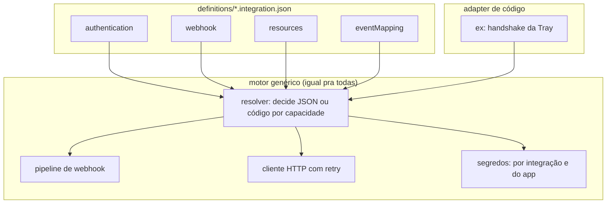
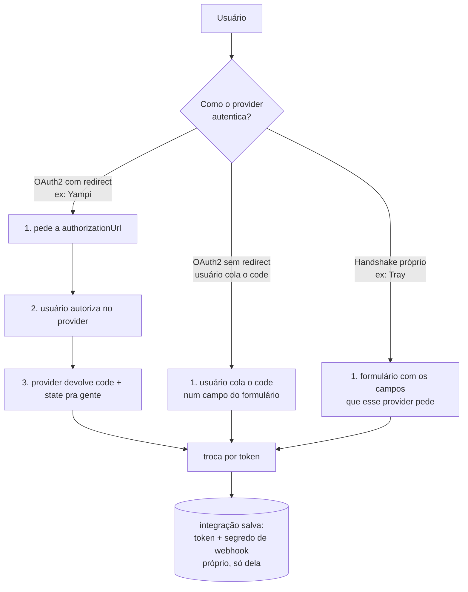
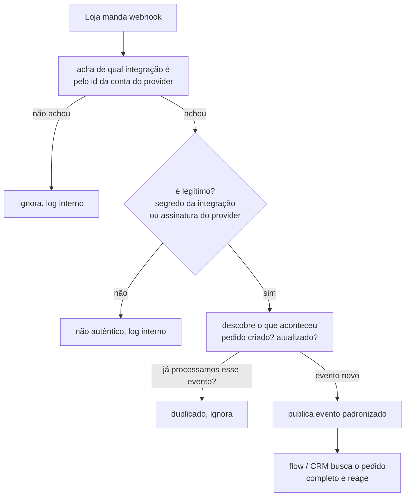

# integration-platform

## O problema

Toda integração de e-commerce (Tray, Yampi, e as que vierem depois) precisa das mesmas quatro coisas: conectar a loja, receber webhook, buscar dado na API do provider e traduzir isso pro resto do sistema. Hoje cada integração nova repete esse trabalho do zero, e cada uma tem um jeito ligeiramente diferente de fazer a mesma coisa.

## A ideia central

Toda integração tem exatamente **4 capacidades**:

1. **authentication** — como logar e manter o token válido
2. **webhook** — como validar e entender o que a loja mandou
3. **resources** — como buscar dado na API do provider (um pedido, uma lista de status)
4. **eventMapping** — como traduzir isso pro resto do sistema (flow, CRM)

Cada capacidade é **JSON ou código, nunca os dois**:

- Padrão (OAuth2 normal, webhook com assinatura HMAC, um `GET` simples por id) → só JSON, o motor genérico já sabe executar.
- Torto, só desse provider (handshake de autenticação específico, formato de evento esquisito) → um pedacinho de código só pra essa parte; o resto continua em JSON.

Isso faz a maioria das integrações futuras serem **só um arquivo JSON novo**, sem escrever ou revisar código.

## Exemplo real: Yampi vs Tray

| Capacidade | Yampi | Tray |
|---|---|---|
| authentication | JSON — OAuth2 com redirect (PKCE) | código — handshake próprio da Tray |
| webhook | JSON — assinatura HMAC | JSON — segredo por loja, sem assinatura |
| resources | JSON | JSON (pedido + lista de status paginada) |
| eventMapping | JSON | código — status customizado da loja, telefone com DDI |

A Yampi segue o padrão quase todo; a Tray só precisa de código nos dois pontos onde ela é diferente de todo mundo.

## Conectar uma loja: 3 jeitos, 1 resultado

Nem toda autenticação funciona igual. O motor sabe lidar com três:

## Um webhook chegando

O provider sempre recebe "ok" na resposta, não importa o resultado — erro, duplicado ou sucesso ficam só no log interno, nunca voltam pra loja.

## O que é sempre da plataforma, não do JSON

Não importa a integração, isso é sempre igual e nunca se repete:

- separar por cliente (tenant) e por conta do provider
- segredo de webhook gerado e guardado por integração, não pelo código de cada provider
- não processar o mesmo evento duas vezes (dedupe)
- esconder token e campo sensível de qualquer resposta de API
- log padronizado: qual integração, qual passo, se veio do JSON ou do código

## Onde isso está hoje

Vive em `integration-platform/`, fora do CRM antigo (`modules/integrations`), sem afetar quem já está em produção. Tray e Yampi já estão implementadas nesse novo modelo — conectar, webhook, buscar dado, esconder dado sensível na resposta da API. O que falta é ligar isso ao motor de flow do CRM.
