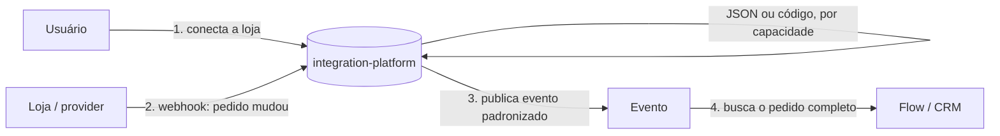

# integration-platform — a ideia em simples

## O problema

Toda integração de e-commerce (Tray, Yampi, e as que vierem depois) precisa das mesmas quatro coisas: conectar a loja, receber webhook, buscar dado na API do provider e traduzir isso pro resto do sistema. Hoje cada integração nova repete esse trabalho do zero, e cada uma tem um jeito ligeiramente diferente de fazer a mesma coisa.

## A ideia central

Toda integração tem exatamente **4 capacidades**:

1. **authentication** — como logar e manter o token válido
2. **webhook** — como validar e entender o que a loja mandou
3. **resources** — como buscar dado na API do provider (um pedido, uma lista de status)
4. **eventMapping** — como traduzir isso pro resto do sistema (flow, CRM)

Cada capacidade é **JSON ou código, nunca os dois**:

- Se o jeito do provider fizer é "padrão" (OAuth2 normal, webhook com assinatura HMAC, um `GET` simples por id) → só JSON, o motor genérico já sabe executar.
- Se tiver algo torto que só esse provider faz (um handshake de autenticação específico, um formato de evento esquisito) → vira um pedacinho de código só pra essa parte, o resto continua em JSON.

O motor nunca mistura os dois na mesma capacidade. Isso faz a maioria das integrações futuras serem **só um arquivo JSON novo**, sem precisar escrever ou revisar código.

## Exemplo real: Yampi vs Tray

| Capacidade | Yampi | Tray |
|---|---|---|
| authentication | JSON (OAuth2 padrão) | código (handshake próprio da Tray) |
| webhook | JSON (assinatura HMAC) | JSON (segredo próprio por loja, sem assinatura) |
| resources | JSON | JSON |
| eventMapping | JSON | código (status customizado da loja, telefone com DDI) |

A Yampi segue o padrão quase todo; a Tray só precisa de código nos dois pontos onde ela é diferente de todo mundo. O resto (webhook, busca de pedido) é JSON igual.

## O que é sempre da plataforma, não do JSON

Não importa a integração, isso é sempre igual e nunca se repete:

- separar por cliente (tenant) e por conta do provider
- segredo de webhook gerado e guardado por integração, não pelo código de cada provider
- não processar o mesmo evento duas vezes (dedupe)
- esconder token e campo sensível de qualquer resposta de API
- log padronizado: qual integração, qual passo, se veio do JSON ou do código

## O fluxo, em 4 passos

1. **Conectar**: usuário preenche um formulário (ou faz OAuth) → a integração fica salva, com token guardado e um segredo de webhook só dela.
2. **Webhook chega**: a loja avisa "pedido mudou" → a plataforma acha de qual integração é isso, confirma que é legítimo, e descobre o que aconteceu.
3. **Evento sai**: isso vira um evento padronizado (igual pra qualquer provider) e é publicado.
4. **Alguém reage**: o flow ou outra parte do CRM busca o dado completo do pedido e faz o que precisar.

## Onde isso está hoje

Vive em `integration-platform/`, fora do CRM antigo (`modules/integrations`), sem afetar quem já está em produção. Tray e Yampi já estão implementadas nesse novo modelo. O que falta é ligar isso ao motor de flow do CRM — hoje o foco foi só terminar o motor (conectar, webhook, buscar dado, e esconder dado sensível na API).
